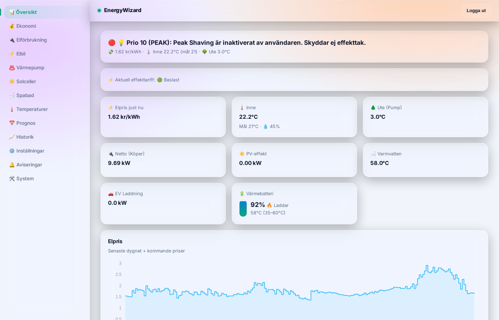
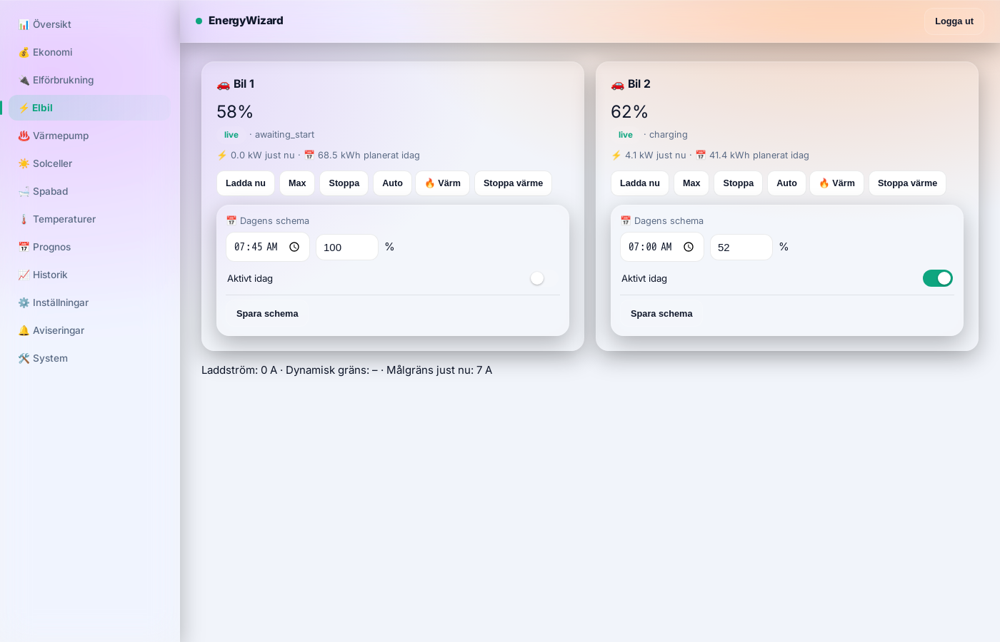

# EnergyWizard Open

**🇸🇪 [Svenska](README.md) · 🇬🇧 English**

[](https://github.com/sponsors/murre87)
[](LICENSE)
[](https://github.com/murre87/energywizard/actions/workflows/tester.yml)
[](https://murre87.github.io/energywizard/en/)
[](TRANSLATING.md)

**An open control system that makes minute-by-minute decisions for the whole house based on
the electricity price** - not a point solution for a single thing. EV charging, heat pump, solar
export, home battery, spa and the main fuse are coordinated together, built on top of
[Home Assistant](https://www.home-assistant.io/) so it talks to hardware that already works there
instead of inventing new protocol code. Open source, free, no subscription.



- 🚗 **EV** - charges to your chosen time/level in the cheapest hours.
- 🌡️ **Heat pump** - lowers the heat automatically when power is expensive, "charges" the house's
  own thermal mass when it is cheap.
- 🔋 **Home battery** - a daily plan, quarter by quarter: when to charge, save and discharge.
- ☀️ **Solar export** - at negative prices, export is regulated down to zero (the sun still covers the house and
  charges the battery; only what would be sold is curtailed). Above 0, surplus is exported as usual.
- 🛁 **Spa with bathing times** - set the days and times you usually bathe. Outside them the spa may cool
  to an eco floor and is heated back up in time for the next bath, in the cheapest hours. Run against our
  own history: 25-34 % less electricity for the spa, about 22 % in winter too
  ([how it works](https://murre87.github.io/energywizard/en/kunskapsbank/hot-tub-by-price.html)).
- ⚡ **Fuse guard** - watches the main fuse so you avoid overloads.
- 📱 **Own app** (`ewapp`, mobile/PWA) and a **desktop/tablet view** (`webdashboard`) with full control,
  not just read-outs. Swedish and English.

| App: Right now | App: the house | Today's plan |
|---|---|---|
|  |  |  |

**Right now**, at the top of the app and on the web Overview, shows the same thing the same way: sun, grid and
battery on the left, the house in the middle and what draws power on the right (heat pump, hot water, spa, EV),
with dots moving in the direction the power flows.



See the [EnergyWizard site](https://murre87.github.io/energywizard/en/) for real savings figures (measured
against what the same power would have cost at the day's average price, not a guessed percentage) and a
knowledge base about how the control works.

## Local learning, not a black box

For Docker and Kubernetes image update status, scheduled checks and a manual check
button, see [Image update checks](docs/image-updates.md).

The core is a deterministic priority engine (`smartbox/gpm.py`), not a guessing AI - but it is helped by
simple machine learning trained locally on **your own house's** history (`smartbox/learning.py`): how fast
the house and the spa heat up and cool down depending on outdoor temperature and sunshine. The models are
retrained automatically and used by `smartbox/mpc.py` to predict how much heating is actually needed before
power gets expensive. The battery plan learns the battery's real efficiency, capacity and power the same way.
No data is shared between installations.

## Run as a Home Assistant add-on (Supervisor/HAOS)

[](https://my.home-assistant.io/redirect/supervisor_add_addon_repository/?repository_url=https%3A%2F%2Fgithub.com%2Fmurre87%2Fenergywizard)

Includes everything: the engine, the web dashboard (port 8503, with the entity picker) and the mobile app
(port 8502), plus its own database. Just set a `dashboard_password` in the add-on options. See
[ha-addon/smartbox/DOCS.md](ha-addon/smartbox/DOCS.md) for what is verified and what is not.

## Getting started (Docker, one line)

Running Home Assistant OS? Use the add-on above instead.

Otherwise, on any computer with Docker (a Raspberry Pi, NUC or NAS):

```bash
curl -fsSL https://raw.githubusercontent.com/murre87/energywizard/main/install.sh | bash
```

Then open `http://your-computer:8503`. The setup wizard does the rest (pick **English** on the first screen):

1. **Choose a password.**
2. **Connect Home Assistant.** Enter the address and paste a token. The wizard tests the connection before saving.
3. **Pick your devices.** The entity picker finds them in Home Assistant. Tick what you have and press **Save and start**.

No file needs editing. Everything is stored in `~/energywizard/data`, and EnergyWizard updates itself.

🕶️ **Want to try it safely first?** Turn on **Shadow mode** under Settings. EnergyWizard then calculates and plans as usual
next to your current system, but sends nothing to your devices, and shows a list of what it *would* have done.

Prefer doing it yourself? `docker-compose.enkel.yml` is enough - save it as `docker-compose.yml` and run
`docker compose up -d`. Or without compose:

```bash
docker run -d --name energywizard --restart unless-stopped -p 8503:8503 -p 8502:8502 -v energywizard:/data ghcr.io/murre87/energywizard:latest
```

**Australia / Amber:** select Australia (AUD) in price settings and choose your Home Assistant price sensor.
See [Australian prices and dynamic forecast refreshes](docs/australian-prices.md) for GST, timezone, and current-price setup.

## Supported hardware

Everything goes through the device's own Home Assistant integration or a local API, never our own protocol
code against unknown registers. ✅ = running in real homes. The rest is built against the integrations' source
code and waits for a beta tester with real hardware.

| Area | Supported |
|---|---|
| 🌡️ **Heat pump** | ✅ Thermia via Husdata · ✅ anything with a `climate` entity in HA · NIBE S series (local API) · NIBE/Bosch/Atlantic/Daikin via myUplink · Panasonic Aquarea via HeishaMon · Thermia via ThermIQ (HA integration) |
| 🔋 **Home battery** | controls: Solax Gen4-6 and Growatt (Solax Modbus), Solis (solis_modbus) and Fronius Gen24 (fronius_modbus), e.g. with BYD HVS, FoxESS (local and cloud), HomeWizard Plug-In Battery · reads: Felicity, SolarEdge, GivEnergy, Huawei Luna, Sonnen, Victron and others. Five planning styles and a choice whether the battery may sell to the grid. |
| ☀️ **Solar** | ✅ SolarEdge · Huawei SUN2000 · Growatt · Sungrow · Fronius · generic export limit (Solis, Solplanet, Sigenergy and others) |
| ⚡ **Power meter** | ✅ Tibber Pulse · HomeWizard P1 · P1/HAN meters with power in HA |
| 🚗 **EV** | ✅ Tesla · ✅ Nissan · generic (any HA entity) |
| 🔌 **Charger** | ✅ Easee · OCPP (e.g. Charge Amps, cFos, FoxESS) · generic (`switch`/`number`) |
| 🛁 **Spa** | ✅ Gecko · Balboa · Shelly relay |

How the battery behaves depending on your choices, with pictures:
[Do you have a home battery?](https://murre87.github.io/energywizard/en/kunskapsbank/home-battery.html) ·
heat pumps: [Controlling a heat pump by price](https://murre87.github.io/energywizard/en/kunskapsbank/controlling-a-heat-pump-by-price.html).

**Several inverters?** With the generic solar driver (`driver: generic_number`), `pv_power_w` and `today_kwh` can be a
list. Add `sum_inverters: true` under `entities` to add them up. Without it the list is a fallback in order, e.g. the
same inverter over Modbus first and the cloud as backup.

**"Ready by" from Home Assistant:** each car can have a `ready_by` entity (an `input_datetime` with date and time,
time only, or a timestamp sensor) and optionally `ready_soc` (charge level in %). When the time is ahead it overrides
the weekly schedule, and a change replans charging at once:

```yaml
evs:
  - id: car
    entities:
      ready_by: input_datetime.car_ready_by
      ready_soc: input_number.car_ready_percent   # optional, otherwise 100 %
```

**NIBE without a room setpoint** (e.g. via nibegw and the Nibe Heat Pump integration): the setup wizard maps the heating
curve offset (47011) as `curve_offset`, and EnergyWizard controls the pump with it. Default 2 steps per degree around
20.5 °C within −5…+5 (`offset_steps_per_c`, `offset_base_c`, `offset_min`, `offset_max` under `heat_pump:`).

**Your own loads** (e.g. smart plugs on a washing machine or sauna) show as their own rows in "What is drawing power"
and are subtracted from the unexplained load:

```yaml
loads:
  - name: Washing machine
    power: sensor.washer_power
  - name: Sauna
    power: [sensor.sauna_l1_power, sensor.sauna_l2_power]   # a list is summed
```

Missing your brand? The generic drivers (`generic_*`) already cover most cases as long as the device works in
Home Assistant. For brand-specific control, see `smartbox/drivers/*.py` for the interfaces - contributions welcome.

## Telemetry (always on in EnergyWizard's builds)

**Telemetry is always on in EnergyWizard's own builds and has no off switch.** If you do not want to share what is
listed below, do not use those builds. EnergyWizard is free software under AGPL-3.0: you may modify the code, including
removing the telemetry, and use and distribute the modified version under the license. It helps the developer see which equipment is used and find errors in other installations before people have to report them.
Sent once a day and at start, to `https://energywizzard.profitalgos.com/telemetry`:

- **A random installation ID** (created at first start, stored in `/data/energywizard.json`, sent hashed). Nothing that can be tied to you.
- **Equipment:** the driver per category, brand and model from Home Assistant's device registry, e.g. `heatpump:generic_climate@NIBE#S1255`, `meter:ha@Tibber`, and where the indoor temperature comes from (sensors in HA, the heat pump's sensor or none). No entity ids.
- **Settings:** price source, country, whether the battery is controlled or only read (and which preset), shadow mode and time-of-use tariff on/off.
- **Approximate sizes:** battery and car in ranges (e.g. `10-15kWh`), the main fuse in amperes.
- **Temperatures:** indoor and outdoor, rounded to whole degrees, once a day.
- **Errors:** where in the code an error happened (`module.function`) and its type (e.g. `ConnectionError`), at most once a day per error. **Never the error message**, as it can contain addresses or names. Errors are collected and automatically become issues here on GitHub (label `auto-fel`), with nothing that identifies a house.
- Version number and a timestamp.

Never: names, addresses, location, other measurements, electricity prices, fees or history. See `smartbox/telemetry.py` for exactly
what is sent.

## 🌍 Translate

The web and the mobile app are available in Swedish and English. The language is chosen in the setup wizard and
can be changed under Settings. Anyone can fix a text or add a new language directly on GitHub, without
programming: see [TRANSLATING.md](TRANSLATING.md).

## ❤️ Support the project

EnergyWizard is free, without subscription or ads, and will stay that way. The most expensive part is not the
code but **verifying against real hardware**.

Much of the code is written, reviewed and tested together with Claude, an AI that costs money for every hour it
works. Over the past few weeks, developing EnergyWizard has cost around €1,000, and everything is shared for free
with everyone who uses it. If you think the project is worth it, we would be very grateful for a sponsorship, big
or small.

<p>
  <a href="https://github.com/sponsors/murre87"></a>
</p>

- ⭐ **Star the repo** - it makes the project easier to find.
- 🙋 **Become a beta tester** - [open a "Beta tester: my house" issue](https://github.com/murre87/energywizard/issues) and tell us what you have.
- 🐛 **Report bugs** with the log - [open an issue](https://github.com/murre87/energywizard/issues).

## License

EnergyWizard Open is free software under the [GNU Affero General Public License v3.0](LICENSE) (AGPL-3.0).
You may use, modify and share the code freely. Anyone who distributes a modified version, or runs it as a service
for others, must share their source code under the same license.

## Structure

- `smartbox/` – the control engine (main loop, drivers, priority engine).
- `webdashboard/` – desktop/tablet dashboard. `ewapp/` – the mobile app (PWA).
- `docs/` – the public site (GitHub Pages), in Swedish and English.
- Images are built by GitHub (`.github/workflows/docker.yml`) to `ghcr.io/murre87/energywizard-*`.
