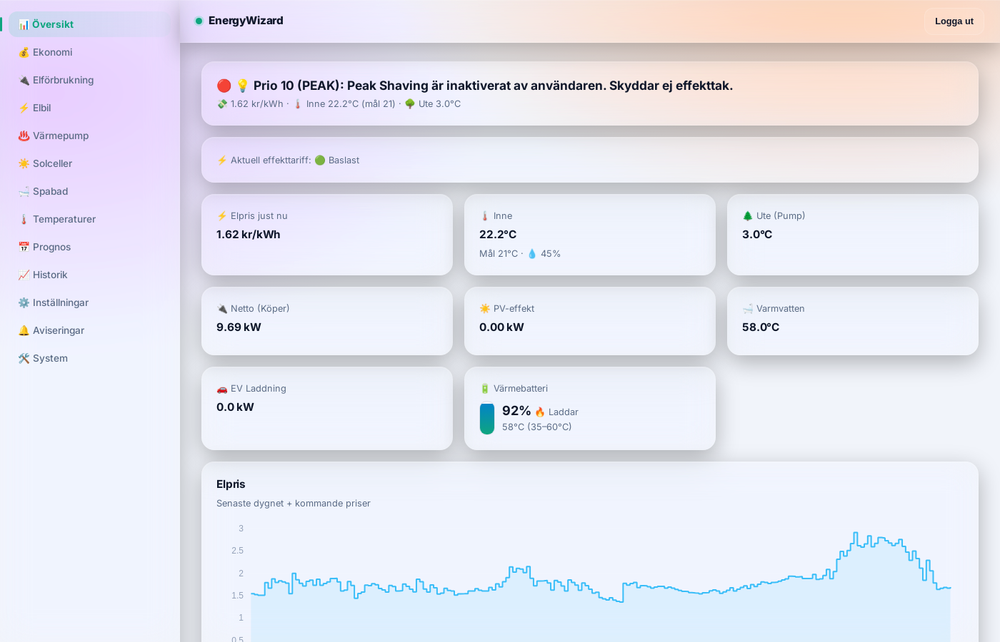

# EnergyWizard Open

**Ett öppet styrsystem som fattar minut-för-minut-beslut för hela huset efter
elpriset** - inte en punktlösning för en enda sak. Elbilsladdning, värmepump,
solcellsexport, spabad och huvudsäkringen koordineras tillsammans, byggt
ovanpå [Home Assistant](https://www.home-assistant.io/) så det pratar med
hårdvara som redan fungerar där istället för att uppfinna ny protokollkod.
Öppen källkod, gratis, inget abonnemang.

- 🚗 **Elbil** - laddar till vald tid/nivå på de billigaste timmarna.
- 🌡️ **Värmepump** - sänker värmen automatiskt när elen är dyr, "laddar"
  husets egen värmetröghet när den är billig.
- ☀️ **Solcellsexport** - stänger av exporten automatiskt vid minuspris,
  släpper den igen när priset går över 0.
- 🛁 **Spabad** - värmer under de billiga timmarna.
- ⚡ **Effektvakt** - håller koll på huvudsäkringen så du slipper överträdelser.
- 📱 **Egen app** (`ewapp`, mobil/PWA) och **dator-/surfplattevy**
  (`webdashboard`) med full styrning, inte bara avläsning.

Se [energywizard-sidan](https://murre87.github.io/energywizard/) för riktiga
besparingssiffror (mätt mot vad samma el hade kostat till dygnets snittpris,
inte en gissad procentsats) och en kunskapsbank om hur styrningen fungerar.

## Lokal inlärning, inte en svart låda

Kärnan är en deterministisk prioritetsmotor (`smartbox/gpm.py`), inte en
gissande AI - men den förstärks av enkel maskininlärning som tränas lokalt på
**ditt eget hus** historik (`smartbox/learning.py`): hur fort huset och
spabadet värms upp och svalnar, beroende på utetemperatur och solinstrålning.
Modellerna räknas om automatiskt när ny data finns och används av
`smartbox/mpc.py` för att förutsäga hur mycket uppvärmning som faktiskt
behövs innan elen blir dyr. Ju längre systemet kört hos dig, desto bättre
anpassat blir det till just ditt hus - men det är per hus, ingen data delas
mellan installationer (en delad/poolad modell är en idé på
[ROADMAP](ROADMAP.md), inte byggd än).

**Status:** huvudstyrloopen (`smartbox/`) går sedan nyligen via en drivrutins-
arkitektur (`smartbox/drivers/`, se `smartbox/house_config.py`) istället för
hårdkodat mot ett specifikt hus. Det gör det genuint möjligt för andra att koppla
in sin egen hårdvara - men bara för de märken som redan har en drivrutin (se
nedan). Fler märken är ett väntat, naturligt sätt att bidra.

## Kör som Home Assistant-tillägg (Supervisor/HAOS)

Paketerar idag bara huvudmotorn (`smartbox`) - mobilappen/webdashboarden
kräver fortfarande docker-compose-vägen nedan. Se
[ha-addon/smartbox/DOCS.md](ha-addon/smartbox/DOCS.md) för vad som är
verifierat och vad som inte är det (aldrig testat mot en riktig Supervisor-
installation).

## Komma igång (docker-compose, alla gränssnitt)

1. Klona repot och kopiera `.env.example` till `.env` - fyll i dina egna värden
   (Home Assistant-IP/token, Postgres-lösenord osv). `.env` checkas aldrig in.
2. Kopiera `config/house_config.example.yaml` till en egen fil (t.ex.
   `config/house_config.yaml`) och fyll i det du faktiskt har - en helt tom fil
   (bara `house_id`) är ett giltigt, testat utgångsläge där alla delsystem bara
   blir overksamma istället för att krascha. Varje enskild entitet är också
   individuellt valfri.
3. Peka `HOUSE_CONFIG_HOST_PATH` i din `.env` mot den filen (standard är annars
   `config/examples/emil_house.yaml`, som är mitt eget hus - bra som referens för
   hur en riktig, ifylld config ser ut).
4. `docker compose up -d` - `smartbox` är huvudmotorn, syns bara i loggarna
   (`docker compose logs -f smartbox`), inget gränssnitt. `webdashboard`
   (dator/surfplatta) och `ewapp` (mobil, PWA) är separata profiler:
   `docker compose --profile webdashboard up -d webdashboard`.
5. Besök gränssnitten på din servers IP:
   - `smartdashboard` (Streamlit-dashboarden): `http://din-server-ip:8501`
   - `webdashboard` (ny dator/surfplatta-vy, kräver steg 4:s profil):
     `http://din-server-ip:8503`
   - `ewapp` (mobil/PWA) publicerar ingen egen port - nås via en reverse
     proxy du själv sätter upp (t.ex. nginx under ett valfritt prefix), se
     `docker-compose.yml`:s kommentarer för `ewapp`.
6. Valfritt, avancerat: kör EnergyWizard under samma adress som din egna Home
   Assistant (för Container-installationer utan Supervisor) - se
   [kunskapsbanksartikeln](https://murre87.github.io/energywizard/kunskapsbank/ha-gateway.html).
   Gatewayn skriver själv ut sin adress i loggarna
   (`docker compose logs ha-gateway`) efter start.

## Vilka märken stöds idag

Drivrutinsarkitekturen (`smartbox/drivers/`) är byggd för att vara
märkesoberoende, men konkreta drivrutiner finns bara för det som redan testats
mot riktig hårdvara:

| Delsystem    | Stödda märken idag           |
|--------------|-------------------------------|
| Värmepump    | Thermia/Husdata (Modbus), + en generisk (HA:s `climate`-entitet - funkar för de flesta) |
| Elbil        | Nissan, Tesla, + en generisk (läser valfri HA-entitet, funkar för de flesta bilar) |
| Laddare      | Easee, + en generisk (HA:s `switch`/`number`-entiteter) |
| Solceller    | SolarEdge, + en generisk (HA:s `number`-entitet - funkar även för Solplanet, Sigenergy, Solis m.fl.) |
| Spabad       | Gecko, Balboa (byggd mot HA:s officiella integration, väntar på verifiering mot riktig hårdvara) |
| Husbatteri   | En generisk (läser SOC/effekt, kan sätta läge via HA:s `select`-entitet - läser bara, fattar inga automatiska laddningsbeslut än) |

Saknas ditt märke? De generiska drivrutinerna (`generic_*`) täcker redan de
flesta fall så länge enheten redan fungerar i Home Assistant - ingen egen
protokollkod behövs. För riktigt märkesspecifik styrning - se
`smartbox/drivers/*.py` för gränssnitten och skicka gärna ett bidrag.

Se [ROADMAP.md](ROADMAP.md) för vad som är nästa rimliga steg och varför.

## Telemetri (på som standard, lätt att stänga av)

Skickar bara: en hashad, oåterkallelig husidentifierare (`sha256(house_id)`,
inte house_id i klartext), vilka drivrutinkategorier som är aktiva (t.ex.
`solar:solaredge` - inga entity-id:n eller sensorvärden), feltyper vid
kritiska fel i huvudloopen (exceptionens klassnamn, aldrig feltexten), en
grov versionsindikator (git-commit-hash) och en tidsstämpel. Inget annat -
ingen elprisdata, ingen sensorhistorik, ingen plats. Går till den centrala,
publika mottagaren (`https://energywizzard.profitalgos.com/telemetry`) som
standard - det hjälper utvecklaren upptäcka fel i andras installationer utan
att de behöver höra av sig själva. Se `smartbox/telemetry.py` för exakt vad
som skickas och `telemetry-collector/` för mottagarsidan (en separat, valfri
tjänst - `docker compose --profile telemetry-collector up -d` om du vill
köra din egen).

Vill du inte skicka något alls, sätt `TELEMETRY_OPT_IN=false` i din `.env`.

## Struktur

- `smartbox/` – styrmotorn (huvudloopen, drivrutinerna, prioritetsmotorn).
- `webdashboard/` – ny dator-/surfplatte-dashboard. `ewapp/` – mobilappen (PWA).
- `smartdashboard/` – äldre Streamlit-dashboard, fasas ut.
- `docs/` – den publika sidan (GitHub Pages).
- Bilderna byggs av GitHub (`.github/workflows/docker.yml`) till
  `ghcr.io/murre87/energywizard-*` och hämtas automatiskt av Watchtower.
