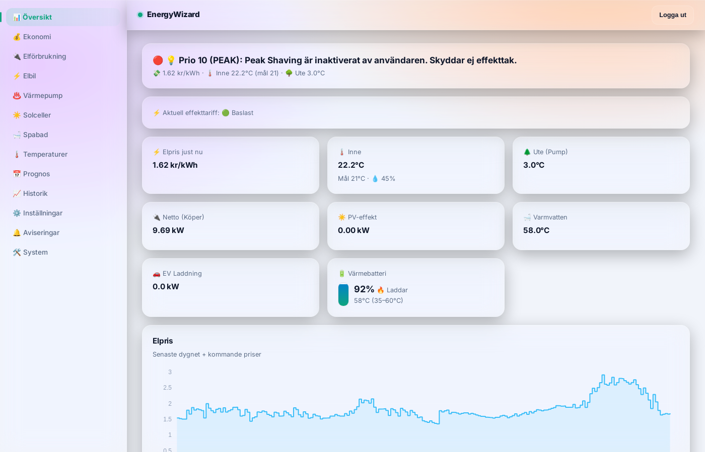
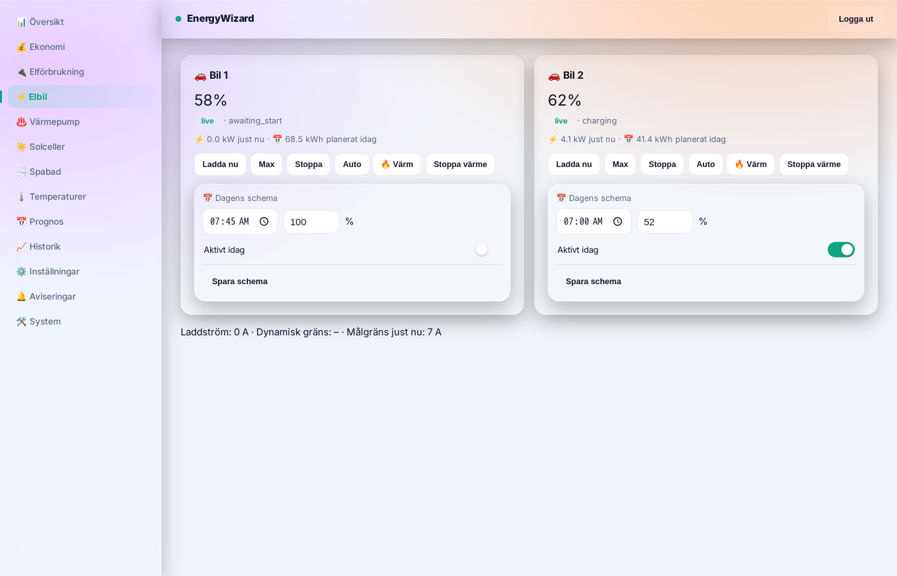

# EnergyWizard Open

Versionskontroll för Docker/Kubernetes med schemalagda och manuella kontroller:
[konfigurationsguide](docs/image-updates.md).

**🇸🇪 Svenska · 🇬🇧 [English](README.en.md)**

[](https://github.com/sponsors/murre87)
[](LICENSE)
[](https://github.com/murre87/energywizard/actions/workflows/tester.yml)
[](https://murre87.github.io/energywizard/)
[](TRANSLATING.md)

**Ett öppet styrsystem som fattar minut-för-minut-beslut för hela huset efter
elpriset** - inte en punktlösning för en enda sak. Elbilsladdning, värmepump,
solcellsexport, husbatteri, spabad och huvudsäkringen koordineras tillsammans, byggt
ovanpå [Home Assistant](https://www.home-assistant.io/) så det pratar med
hårdvara som redan fungerar där istället för att uppfinna ny protokollkod.
Öppen källkod, gratis, inget abonnemang.



- 🚗 **Elbil** - laddar till vald tid/nivå på de billigaste timmarna.
- 🌡️ **Värmepump** - sänker värmen automatiskt när elen är dyr, "laddar"
  husets egen värmetröghet när den är billig.
- 🔋 **Husbatteri** - dygnsplan kvart för kvart: när det ska ladda, spara och ladda ur.
- ☀️ **Solcellsexport** - vid minuspris regleras exporten ner till noll (solen täcker fortfarande huset och
  laddar batteriet, bara det som skulle säljas stryps). Över 0 kr exporteras överskottet som vanligt.
- 🛁 **Spabad med badtider** - ställ in vilka dagar och tider ni brukar bada. Utanför dem får badet
  svalna till ett eco-golv och värms upp i tid till nästa badtid, på de billigaste timmarna.
  Kört mot vår egen historik: 25-34 % mindre el till badet, ca 22 % även vintertid
  ([så funkar det](https://murre87.github.io/energywizard/kunskapsbank/spabad.html)).
- ⚡ **Effektvakt** - håller koll på huvudsäkringen så du slipper överträdelser.
- 📱 **Egen app** (`ewapp`, mobil/PWA) och **dator-/surfplattevy**
  (`webdashboard`) med full styrning, inte bara avläsning.

| Appen: Just nu | Appen: huset | Dagens plan |
|---|---|---|
|  |  |  |

**Just nu** överst i appen och på webbens Översikt visar samma sak på samma sätt: sol, nät och batteri till
vänster, huset i mitten och det som drar el till höger (värmepump, varmvatten, spabad, elbil), med prickar som
rör sig åt det håll elen går.



Se [energywizard-sidan](https://murre87.github.io/energywizard/) för riktiga
besparingssiffror (mätt mot vad samma el hade kostat till dygnets snittpris,
inte en gissad procentsats) och en kunskapsbank om hur styrningen fungerar.

## Lokal inlärning, inte en svart låda

Kärnan är en deterministisk prioritetsmotor (`smartbox/gpm.py`), inte en
gissande AI - men den förstärks av enkel maskininlärning som tränas lokalt på
**ditt eget hus** historik (`smartbox/learning.py`): hur fort huset och
spabadet värms upp och svalnar, beroende på utetemperatur och solinstrålning.
Modellerna räknas om automatiskt när ny data finns och används av
`smartbox/mpc.py` för att förutsäga hur mycket uppvärmning som faktiskt
behövs innan elen blir dyr. Ju längre systemet kört hos dig, desto bättre
anpassat blir det till just ditt hus - men det är per hus, ingen data delas
mellan installationer (en delad/poolad modell är en idé på
[ROADMAP](ROADMAP.md), inte byggd än).

**Status:** huvudstyrloopen (`smartbox/`) går sedan nyligen via en drivrutins-
arkitektur (`smartbox/drivers/`, se `smartbox/house_config.py`) istället för
hårdkodat mot ett specifikt hus. Det gör det genuint möjligt för andra att koppla
in sin egen hårdvara - men bara för de märken som redan har en drivrutin (se
nedan). Fler märken är ett väntat, naturligt sätt att bidra.

## Kör som Home Assistant-tillägg (Supervisor/HAOS)

[](https://my.home-assistant.io/redirect/supervisor_add_addon_repository/?repository_url=https%3A%2F%2Fgithub.com%2Fmurre87%2Fenergywizard)

Innehåller allt: huvudmotorn, webdashboard (port 8503, med entitetsväljaren)
och mobilappen (port 8502), plus en egen databas. Sätt bara ett
`dashboard_password` i tilläggets inställningar. Se
[ha-addon/smartbox/DOCS.md](ha-addon/smartbox/DOCS.md) för vad som är
verifierat och vad som inte är det (aldrig testat mot en riktig Supervisor-
installation).

## Komma igång (Docker, en rad)

Har du Home Assistant OS? Använd tillägget ovan i stället.

Annars, på en dator med Docker (t.ex. en Raspberry Pi, NUC eller NAS):

```bash
curl -fsSL https://raw.githubusercontent.com/murre87/energywizard/main/install.sh | bash
```

Öppna sedan `http://din-dator:8503`. Startguiden i webben tar resten:

1. **Välj ett lösenord.**
2. **Koppla Home Assistant.** Skriv in adressen och klistra in en token. Guiden testar anslutningen innan den sparar.
3. **Välj dina prylar.** Entitetsväljaren hittar dem i Home Assistant. Kryssa i det du har och tryck **Spara och starta**.

Ingen fil behöver redigeras. Allt sparas i `~/energywizard/data`, och EnergyWizard uppdaterar sig själv.

🕶️ **Vill du prova säkert först?** Slå på **Skuggläge** under Inställningar. Då räknar och planerar EnergyWizard som vanligt
bredvid ditt nuvarande system, men skickar ingenting till prylarna, och du ser en lista över vad den *hade* gjort.

Vill du hellre göra det själv räcker det med `docker-compose.enkel.yml`, som du sparar som
`docker-compose.yml` och startar med `docker compose up -d`. Eller utan compose:

```bash
docker run -d --name energywizard --restart unless-stopped -p 8503:8503 -p 8502:8502 -v energywizard:/data ghcr.io/murre87/energywizard:latest
```

<details>
<summary>Utvecklare: köra från källkoden med docker-compose.yml (flera containrar)</summary>

1. Klona repot. Kopiera `.env.example` till `.env` och fyll i `HA_URL` (t.ex.
   `http://192.168.1.10:8123`), `HA_TOKEN` och Postgres-uppgifterna. Kopiera
   `secrets/dashboard.env.example` till `secrets/dashboard.env` och sätt ett lösenord.
2. Skapa `config/house_config.yaml`. En fil med bara `house_id: "mitt-hus"` räcker för
   att starta. Se `config/house_config.example.yaml` för allt som går att ställa in, och
   `config/examples/emil_house.yaml` för ett riktigt, ifyllt hus.
   Sätt `HOUSE_CONFIG_HOST_PATH=./config/house_config.yaml` i `.env`.
3. `docker compose --profile webdashboard up -d`. Motorn (`smartbox`) syns i
   `docker compose logs -f smartbox`, webben på port 8503.

Mobilappen (`ewapp`) har ingen egen port. Den nås via en reverse proxy, se
kommentarerna i `docker-compose.yml`. Vill du köra EnergyWizard under samma adress
som Home Assistant (Container-installation utan Supervisor), se
[kunskapsbanksartikeln](https://murre87.github.io/energywizard/kunskapsbank/ha-gateway.html).
</details>

## Vilka märken stöds idag

Allt går via enhetens egen Home Assistant-integration eller ett lokalt API, aldrig via egen
protokollkod mot okända register. Det som körs i skarp drift är markerat ✅. Resten är byggt mot
integrationernas källkod och väntar på en betatestare med riktig hårdvara.

| Delsystem | Stöds |
|---|---|
| 🌡️ **Värmepump** | ✅ Thermia via Husdata · ✅ alla med `climate`-entitet i HA · NIBE S-serien (lokalt API) · NIBE/Bosch/Atlantic/Daikin via myUplink · Panasonic Aquarea via HeishaMon · Thermia via ThermIQ (HA-integrationen) |
| 🔋 **Husbatteri** | styr: Solax Gen4-6 och Growatt (Solax Modbus), Solis (solis_modbus) och Fronius Gen24 (fronius_modbus), t.ex. med BYD HVS, FoxESS (lokalt och moln), HomeWizard Plug-In Battery · läser: Felicity, SolarEdge, GivEnergy, Huawei Luna, Sonnen, Victron m.fl. Planeringsstil i fem steg och val om batteriet får sälja till nätet. |
| ☀️ **Solceller** | ✅ SolarEdge · Huawei SUN2000 · Growatt · Sungrow · Fronius · generisk exportgräns (Solis, Solplanet, Sigenergy m.fl.) |
| ⚡ **Elmätare** | ✅ Tibber Pulse · HomeWizard P1 · P1/HAN-mätare med effekt i HA |
| 🚗 **Elbil** | ✅ Tesla · ✅ Nissan · generisk (valfri HA-entitet) |
| 🔌 **Laddbox** | ✅ Easee · OCPP (t.ex. Charge Amps, cFos, FoxESS) · generisk (`switch`/`number`) |
| 🛁 **Spabad** | ✅ Gecko · Balboa · Shelly-relä |

Hur batteriet fungerar beroende på dina val, med bilder:
[Har du ett husbatteri?](https://murre87.github.io/energywizard/kunskapsbank/husbatteri.html) ·
värmepumparna: [Så styrs värmepumpen](https://murre87.github.io/energywizard/kunskapsbank/styra-varmepump-efter-elpris.html).

**Flera växelriktare?** Med den generiska soldrivrutinen (`driver: generic_number`) kan `pv_power_w` och `today_kwh`
vara en lista. Lägg till `sum_inverters: true` under `entities` så summeras de. Utan den är listan en reserv i tur och
ordning, t.ex. samma växelriktare via Modbus först och molnet som reserv.

**"Klar senast" från Home Assistant:** varje bil kan få en `ready_by`-entitet (en `input_datetime` med datum och tid,
bara tid, eller en sensor med tidsstämpel) och valfritt `ready_soc` (laddnivå i %). När tiden ligger framåt går den
före veckoschemat, och ändras den räknas laddplanen om direkt:

```yaml
evs:
  - id: bil
    entities:
      ready_by: input_datetime.bil_klar_senast
      ready_soc: input_number.bil_klar_procent   # valfritt, annars 100 %
```

**NIBE utan rumsbörvärde** (t.ex. via nibegw och integrationen Nibe Heat Pump): guiden kopplar värmekurvans
förskjutning (47011) som `curve_offset`, och EnergyWizard styr pumpen med den. Standard är 2 steg per grad kring 20,5 °C
inom −5…+5 (`offset_steps_per_c`, `offset_base_c`, `offset_min`, `offset_max` under `heat_pump:`).

**Egna laster** (t.ex. smartpluggar på tvättmaskin eller bastu) syns som egna rader i "Vad drar strömmen" och räknas
bort från det oförklarade:

```yaml
loads:
  - name: Tvättmaskin
    power: sensor.tvattmaskin_power
  - name: Bastu
    power: [sensor.bastu_l1_power, sensor.bastu_l2_power]   # en lista summeras
```

Saknas ditt märke? De generiska drivrutinerna (`generic_*`) täcker redan de
flesta fall så länge enheten redan fungerar i Home Assistant - ingen egen
protokollkod behövs. För riktigt märkesspecifik styrning - se
`smartbox/drivers/*.py` för gränssnitten och skicka gärna ett bidrag.

Se [ROADMAP.md](ROADMAP.md) för vad som är nästa rimliga steg och varför.

## Telemetri (alltid på i EnergyWizards byggen)

**Telemetrin är alltid påslagen i EnergyWizards egna byggen och har ingen avstängning.** Vill du inte dela det som står
nedan, använd inte de byggena. EnergyWizard är fri programvara under AGPL-3.0: du får ändra koden, även ta bort
telemetrin, och använda och sprida den ändrade versionen enligt licensen. Den hjälper utvecklaren att se vilken utrustning som används och att hitta fel hos andra innan de behöver höra av sig.
Skickas en gång per dygn och vid start, till `https://energywizzard.profitalgos.com/telemetry`:

- **Ett slumpat installations-ID** (skapas vid första start och sparas i `/data/energywizard.json`, skickas hashat). Inget som går att koppla till dig.
- **Utrustningen:** drivrutin per kategori, märke och modell enligt Home Assistants enhetsregister, t.ex. `heatpump:generic_climate@NIBE#S1255`, `meter:ha@Tibber`, och var innetemperaturen kommer ifrån (givare i HA, värmepumpens givare eller ingen). Inga entitets-ID:n.
- **Inställningar:** priskälla, land, om batteriet styrs eller bara läses (och vilken förinställning), skuggläge och tidstariff på/av.
- **Ungefärliga storlekar:** batteri och elbil i intervall (t.ex. `10-15kWh`), huvudsäkringen i ampere.
- **Temperaturer:** inne och ute, avrundade till hela grader, en gång per dygn.
- **Fel:** var i koden ett fel uppstod (`modul.funktion`) och feltypen (t.ex. `ConnectionError`), högst en gång per dygn och fel. **Aldrig feltexten**, eftersom den kan innehålla adresser eller namn. Felen samlas och blir automatiskt ärenden här på GitHub (etiketten `auto-fel`), utan något som pekar ut ett hus.
- Versionsnummer och en tidsstämpel.

Aldrig: namn, adress, plats, IP-adresser i innehållet, andra mätvärden, elpriser, avgifter eller historik. Se `smartbox/telemetry.py`
för exakt vad som skickas och `telemetry-collector/` för mottagaren.

## 🌍 Översätt

Webben och mobilappen finns på svenska och engelska. Språket väljs i startguiden och kan bytas
under Inställningar. Vem som helst kan rätta en text eller lägga till ett nytt språk direkt på
GitHub, utan att programmera: se [TRANSLATING.md](TRANSLATING.md).

## ❤️ Stöd projektet

EnergyWizard är gratis, utan abonnemang och utan reklam - och ska förbli så.
Det byggs på kvällar och helger, och det dyraste är inte koden utan att
**verifiera mot riktig hårdvara**: en växelriktare, värmepump eller laddbox
som ingen i projektet har kan bara stödjas på riktigt om någon testar den.

Mycket av koden skrivs, granskas och testas tillsammans med Claude, en AI som kostar pengar för varje timme
den arbetar. De senaste veckorna har det kostat runt 1 000 € att utveckla EnergyWizard, och allt delas gratis
med alla som använder det. Tycker du att projektet är värt det blir vi väldigt tacksamma för en sponsring,
stor som liten.

<p>
  <a href="https://github.com/sponsors/murre87"></a>
</p>

| Ditt stöd går till | |
|---|---|
| 🔌 **Hårdvara att verifiera mot** | drivrutiner för fler märken (NIBE S, Huawei, Sungrow, Fronius, OCPP-laddare) |
| ☁️ **Drift** | telemetrimottagaren och testmiljön |
| ⏱️ **Tid** | snabbare svar på ärenden och fler funktioner från [ROADMAP](ROADMAP.md) |

Andra sätt att hjälpa, som är minst lika mycket värda:

- ⭐ **Stjärnmärk repot** - det gör projektet lättare att hitta.
- 🙋 **Bli betatestare** - hör av dig om du har något av märkena som är
  markerade "overifierat" i [kunskapsbanken](https://murre87.github.io/energywizard/kunskapsbank/vaxelriktare.html).
- 🐛 **Rapportera fel** med loggen - [öppna ett ärende](https://github.com/murre87/energywizard/issues).

Senaste hälsningarna från dem som bjudit på en kaffe (uppdateras varje natt av
`.github/workflows/buy-me-a-coffee.yml`):

<!--START_SECTION:buy-me-a-coffee-->
<!--END_SECTION:buy-me-a-coffe-->

## Licens

EnergyWizard Open är fri programvara under [GNU Affero General Public License v3.0](LICENSE) (AGPL-3.0).
Du får använda, ändra och sprida koden fritt. Den som sprider en ändrad version, eller kör den som en tjänst
åt andra, ska dela sin källkod under samma licens.

## Struktur

- `smartbox/` – styrmotorn (huvudloopen, drivrutinerna, prioritetsmotorn).
- `webdashboard/` – ny dator-/surfplatte-dashboard. `ewapp/` – mobilappen (PWA).
- `docs/` – den publika sidan (GitHub Pages).
- Bilderna byggs av GitHub (`.github/workflows/docker.yml`) till
  `ghcr.io/murre87/energywizard-*` och hämtas automatiskt av Watchtower.
